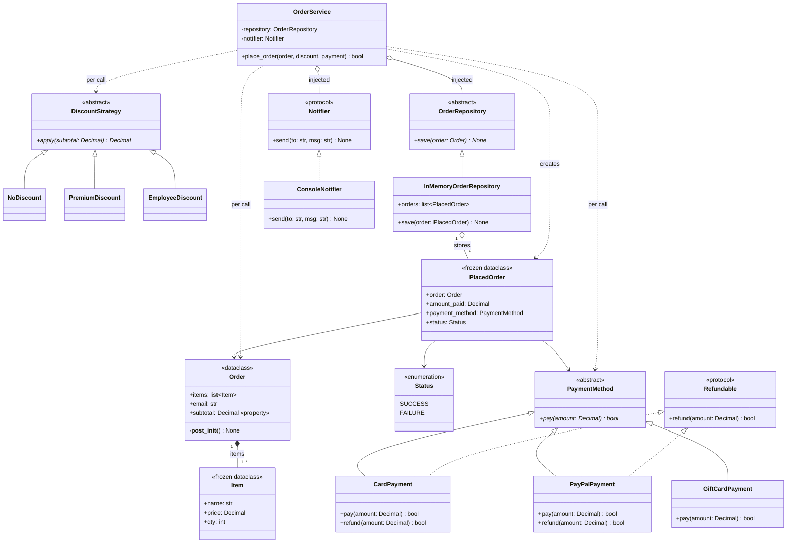

# UML: solid_demo.py (Week 1 Fri)

Drawn by Claude from the code **as it stands on 16 Oct** (known issues included and marked ⚠).
**Sat task:** close this file and redraw it from memory in 10 min, then compare arrow by arrow.

## Class diagram

## Why each arrow
| Relationship | Arrow | Reason |
|---|---|---|
| `NoDiscount` / `Premium` / `Employee` → `DiscountStrategy` | `<\|--` inheritance | They subclass the ABC |
| `Card` / `PayPal` / `GiftCard` → `PaymentMethod` | `<\|--` inheritance | They subclass the ABC |
| `Card`, `PayPal` → `Refundable` | `<\|..` realization | A Protocol is matched **structurally**; there's no inheritance in the code, so it gets a dashed line |
| `GiftCardPayment` → `Refundable` | **no arrow** | This is the ISP fix: gift cards make no refund promise |
| `ConsoleNotifier` → `Notifier` | `<\|..` realization | Same reason: a Protocol, not inherited |
| `OrderService` → repo, notifier | `o--` aggregation | **Injected** from outside via `__init__`; they outlive the service and can be shared. If the service created them itself, it would be composition (and break DIP) |
| `OrderService` → discount, payment, order | `..>` dependency | Only **method parameters**, never stored as fields |
| `OrderService` → `PlacedOrder` | `..>` dependency «creates» | It builds the record but doesn't keep it |
| `Order` → `Item` | `*--` composition, `1..*` | Items belong to the order, and `__post_init__` enforces at least 1 |
| `PlacedOrder` → `Order` / `Status` / `PaymentMethod` | `-->` association | Fields that reference other objects |
| `InMemoryOrderRepository` → `PlacedOrder` | `o--` aggregation, `*` | The repo stores records it didn't create |

## ⚠ Problems the diagram makes visible
1. **`OrderRepository.save(order: Order)` vs `InMemoryOrderRepository.save(order: PlacedOrder)`:** the signatures differ on the two boxes of an inheritance arrow. That's the LSP violation (failing test #4).
2. **`PlacedOrder --> PaymentMethod`:** a data record pointing at a *service* class. It should point to a `PaymentType` enum.
3. **`place_order(...) bool`:** the service creates a `PlacedOrder` but returns `bool`, which loses information.
4. **`Status`** should become `OrderStatus` with `PLACED` / `PAYMENT_FAILED`.

When you fix these on Saturday, update the diagram too. Keep the code and the diagram in sync.
